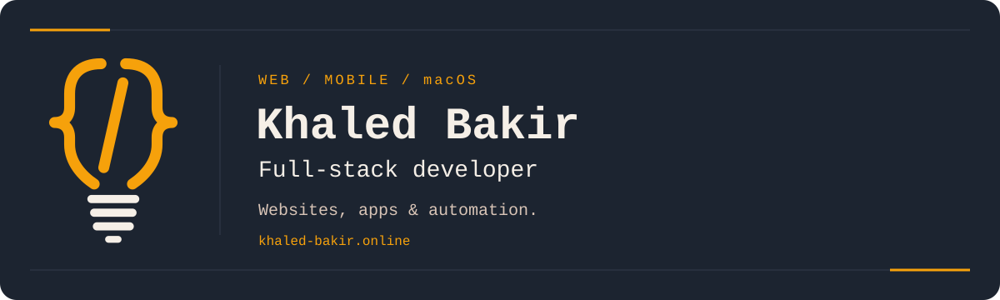

  <a href="https://khaled-bakir.online/"><strong>Portfolio</strong></a> &nbsp; / &nbsp;
  <a href="https://www.linkedin.com/in/khaled-bakir/"><strong>LinkedIn</strong></a> &nbsp; / &nbsp;
  <a href="mailto:khaled.bakir92@gmail.com"><strong>Email</strong></a>

### Hi, I'm Khaled.

I build websites, online shops and full-stack applications for web, mobile and macOS. I also create browser extensions and automations that turn repetitive tasks into useful tools.

Right now, I'm expanding **KURA with Next.js and Supabase**, with daily backups to my VPS.

**Open to freelance projects and full-time opportunities.** Have something in mind? [Let's talk →](https://khaled-bakir.online/#contact)

### Selected work

A few projects from my work — more on [my portfolio](https://khaled-bakir.online/#projects).

| Project | What I built | Stack / Links |
| :--- | :--- | :--- |
| **KURA** | A sports community app with bookings, waitlists, player profiles and rankings. Supports German, English and Arabic. | Next.js · TypeScript · Supabase [Live app ↗](https://koramman.com/) · Private repository |
| **EasyVps** | A native macOS app for managing Linux servers over SSH and SFTP, including files, services, containers and backups. | Swift · SwiftUI · SSH/SFTP [Product website ↗](https://easyvps.app/) · Private repository |
| **Traumplatz** | A responsive business website with service pages, a service-area map and a contact form. | Next.js · React · TypeScript [Live website ↗](https://traumplatz-gartenpflege.de/) · [Source ↗](https://github.com/khaled-bakir92/Traumplatz) |
| **LexArtes** | A legal flashcard learning app with spaced repetition and learning statistics, built as a university team project with Lexmea. | Vue · TypeScript · Java · Spring Boot [Project details ↗](https://khaled-bakir.online/#projects) · Private repository |

### My main stack

  
  
  
  
  

| Area | Technologies I work with |
| :--- | :--- |
| **Web** | JavaScript, TypeScript, React, Next.js, Vue, HTML, CSS, Tailwind CSS |
| **Backend & data** | Python, Node.js, Express, Java, Spring Boot, SQL, MySQL, Supabase |
| **Mobile & desktop** | React Native, Flutter, Swift, SwiftUI, Kotlin |
| **Design & delivery** | Figma, Git, Vercel, VPS deployment and backups |

<strong>Beyond websites: automation & AI tools</strong>

- **Telegram bots & web scraping:** built a bot that finds current apartment listings and sends alerts through Telegram.
- **Chrome extensions:** build tools that add functionality directly to the browser.
- **Custom AI skills:** built a skill that analyzes someone's writing samples and turns their style into reusable instructions for AI-assisted writing.
- **AI-assisted development:** use Codex, Claude Code and MCP-connected tools throughout my workflow.

I'm continuing to develop my backend and server administration skills. I have practical exposure to Docker and CI/CD and am building more experience with both.

---

**Have a project to build or a role to discuss?**  
[Get in touch →](https://khaled-bakir.online/#contact)
